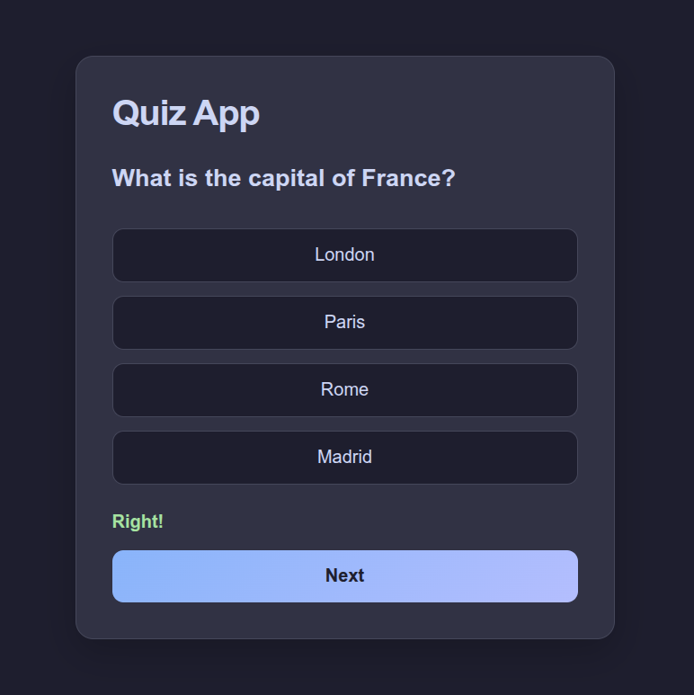

# Quiz App

A simple quiz application built with HTML, CSS and JavaScript. Answer five multiple-choice questions and see your final score at the end.

**Play it here:** https://lexbatol-dev.github.io/quiz-app/

## Features

- Five multiple-choice questions, one at a time.
- Right or Wrong feedback in green or red, and the correct answer is shown when you get one wrong.
- You can't move on until you've answered.
- One attempt per question, so the score can't be inflated by clicking twice.
- Final score at the end, with a Restart button.
- Dark theme using the Catppuccin Mocha colours.

## How to run it

1. Download or clone the repo:
   `git clone https://github.com/lexbatol-dev/quiz-app.git`
2. Open `index.html` in your browser.

There's nothing to install.

## What I learned

- **Nested data:** each question is an object inside an array, and its options are another array. I reach them with `questions[currentNumber].options`.
- **One function, many uses:** I put the code that shows a question into `showQuestion()`, so Next and Restart can both call it instead of repeating the same lines.
- **Bug: score carried over after Restart.** The score was never set back to 0, so round two started with the old points. I fixed it by resetting `score` in the Restart handler.
- **Bug: question 2 ignored my click.** The `answered` variable stayed `true` after I moved on. I fixed it by setting `answered = false` at the top of `showQuestion()`, so every new question starts unanswered.
- **Where a line sits matters.** Putting `answered = true` after the `if / else` locks the question on the first click, right or wrong. When it was inside only the "Right" branch, wrong answers could be retried.

## Future improvements

- Landing page and quiz categories
- Random question order
- Progress indicator ("Question 2 of 5")
- Questions fetched from an API
